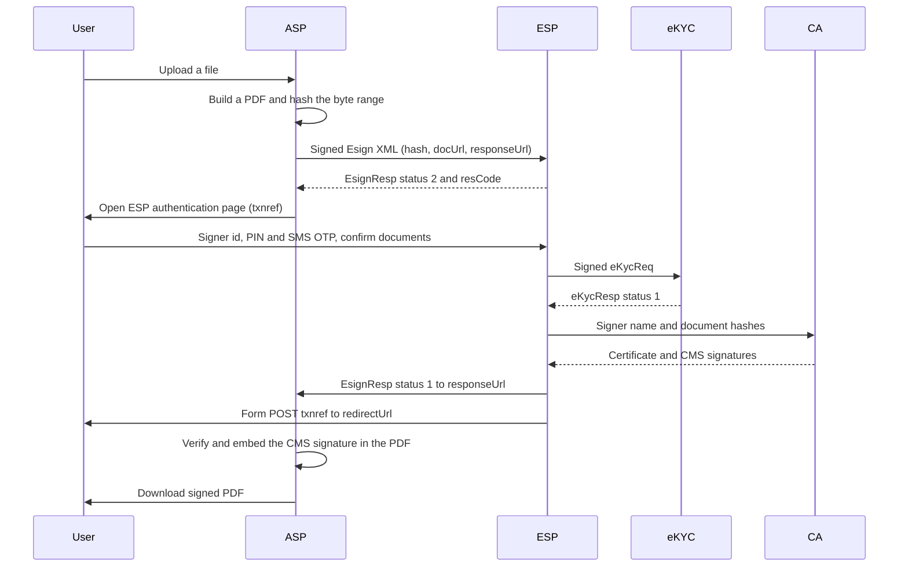

# eSign API 3.3 reference platform

A local Java implementation of the four parties in the **CCA eSign API Specifications, version 3.3** (09 December 2020). Each party is its own Spring Boot application, and a shared library holds the XML contracts, the section 5 error catalogue, XML signatures and hash signing.

You can run the whole signing flow on one machine: upload a file, authenticate with a PIN and OTP, and download a PDF with an embedded CMS signature that chains to a local reference CA.

> **This is a reference, not a production system.** It is not a licensed certifying authority, it does not call UIDAI, a bank or an SMS gateway, it does not use an HSM, and it keeps signer and transaction state in memory.

## Contents

- [Components](#components)
- [How a signature is produced](#how-a-signature-is-produced)
- [Project structure](#project-structure)
- [Prerequisites](#prerequisites)
- [Build](#build)
- [Run](#run)
- [Run from IntelliJ IDEA](#run-from-intellij-idea)
- [Try it](#try-it)
- [Signed PDF](#signed-pdf)
- [HTTP API](#http-api)
- [Configuration](#configuration)
- [Data on disk](#data-on-disk)
- [Security and protocol details](#security-and-protocol-details)
- [Error codes](#error-codes)
- [Troubleshooting](#troubleshooting)
- [Limitations](#limitations)
- [Further documentation](#further-documentation)

## Components

| Folder | Component | Port | Responsibility |
|---|---|---|---|
| [`asp`](asp/README.md) | Application Service Provider | 8081 | The application you would build. Uploads a file, prepares a PDF, asks the ESP to sign the PDF byte-range hash, and writes the returned CMS signature into that PDF. |
| [`esp`](esp/README.md) | eSign Service Provider | 8082 | Checks the ASP request, authenticates the signer, calls eKYC and the CA, and returns `EsignResp`. Has an operator console. |
| [`ekyc`](ekyc/README.md) | eKYC provider | 8083 | PIN, SMS OTP, bank KYC and organisation KYC. KYC attributes stay here; the ASP never receives them. |
| [`ca`](ca/README.md) | Certifying Authority | 8084 | Issues a short-lived end-entity certificate and signs each document hash. The end-entity private key is discarded after the response. |
| [`common`](common/README.md) | Shared library | — | JAXB models, `EsignErrorCode`, XML-DSig, SHA-256, and CMS / raw signatures. Not a server. |

Every running app also exposes `/api/v1/meta`, `/api/v1/meta/error-codes`, `/api/v1/audit`, `/actuator/health`, a home page at `/` and an interactive API guide at `/docs.html`.

## How a signature is produced



1. `POST /api/v1/documents` on the ASP with multipart `file` and `docInfo` (1–50 characters).
2. `POST /api/v1/esign/requests` on the ASP. For `PKCS7`, `PKCS7pdf` and `PKCS7complete` the ASP builds a PDF (an upload that is already a PDF is signed in place; any other file is wrapped, with the original attached) and hashes the PDF byte range. `raw` hashes the original file.
3. The ASP signs an `Esign` XML document (version `3.3`) and posts it to the ESP. The ESP answers `EsignResp` with `status="2"` and a `resCode`, and the ASP returns an `authenticationUrl`.
4. The browser opens the ESP page with `txnref = Base64(txn + "|" + resCode)`.
5. The signer checks each document, enters the signer id, PIN and OTP, and submits. Unchecking a document cancels only that document (error `206`).
6. The ESP asks eKYC to authenticate the signer, asks the CA for a one-time certificate and signatures, posts `EsignResp` to the ASP `responseUrl`, then form-posts the browser back to the ASP `redirectUrl`.
7. The ASP verifies the CMS against the PDF byte-range hash and writes it into the PDF. Download it from `/api/v1/documents/{id}/signed.pdf`.

If the callback is missed, `POST /api/v1/esign/transactions/{txn}/status` on the ASP polls the ESP `EsignStatus` API. Requests that are not completed within `maxWaitPeriod` are expired by the ESP with error `113` and the ASP is called back.

## Project structure

```text
esign/
├── pom.xml                   Parent POM (Spring Boot 3.4.5, Java 17, Bouncy Castle 1.79)
├── common/                   Shared library
│   └── src/main/java/com/esign/common/
│       ├── xml/              JAXB models: Esign, EsignResp, EsignStatus, eKyc, BankKYC, OrgKYC
│       ├── crypto/           XmlSigner (XML-DSig), DocumentSignatures (raw/CMS), KeyMaterial
│       ├── error/            EsignErrorCode (section 5), ApiException, ErrorResponse
│       ├── validation/       EsignXmlValidator, signer id parsing
│       ├── hash/ time/ http/ Hashes, IST timestamps, XML over HTTP
│       ├── audit/ web/       Audit log and shared controllers (/api/v1/audit, /meta/error-codes)
│       └── TxnRef.java       txnref encoding
├── asp/                      AspApplication, AspController, AspEsignService, SignedPdf, AspSigningKeys
├── esp/                      EspApplication, EsignController, EsignGatewayService, AuthPage, AspRegistry
├── ekyc/                     EkycApplication, EkycController, EkycService, AccountDirectory,
│                             BankKycValidator, OrgKycValidator, SubscriberService
├── ca/                       CaApplication, CertificateController, CertificateService
├── scripts/                  start-all, stop-all, demo and tool-resolution scripts
├── docs/                     guide.md, api.md, architecture.md, error-codes.md
├── data/                     Runtime data: keystores, uploads, onboarded ASPs (git-ignored)
├── .tools/                   Bundled JDK 17 and Maven 3.9.9 (git-ignored)
└── .idea/                    IntelliJ IDEA project and shared run configurations
```

Each application keeps its web pages (`index.html`, `docs.html`, `site.css`, `try.js`) in `src/main/resources/static` and its settings in `src/main/resources/application.yml`.

## Prerequisites

- **JDK 17 or newer.** A full JDK is required; a JRE cannot compile. A JDK 17 is bundled in `.tools/jdk/jdk-17.0.20.1+1`.
- **Maven 3.9 or newer.** Maven 3.9.9 is bundled in `.tools/maven/apache-maven-3.9.9`.
- Free ports **8081–8084**.
- Network access to Maven Central for the first build.

The scripts in `scripts/` use `JAVA_HOME` and `mvn` when they are available and fall back to the bundled copies otherwise.

## Build

From the repository root:

```powershell
mvn install
```

This builds the parent POM and all five modules, runs the tests and produces an executable jar per service:

| Jar | Service |
|---|---|
| `ekyc/target/ekyc-1.0.0.jar` | eKYC |
| `ca/target/ca-1.0.0.jar` | CA |
| `esp/target/esp-1.0.0.jar` | ESP |
| `asp/target/asp-1.0.0.jar` | ASP |

Tests only:

```powershell
mvn test
```

`common` tests cover the 69 error codes, PIN hashing, signer ids, XML validation, XML-DSig, and raw plus CMS signatures. `asp` tests cover signed PDF preparation and embedding.

**Using the bundled JDK and Maven** (PowerShell, from the repository root), for example when `JAVA_HOME` points to a JRE:

```powershell
$env:JAVA_HOME = (Resolve-Path ".tools\jdk\jdk-17.0.20.1+1").Path
. .\scripts\tools.ps1
mvn install
```

## Run


Start eKYC and the CA first, then the ESP, then the ASP. All commands are run from the repository root so that the relative `data/` paths resolve.

### Option 1 — start scripts

| Platform | Start | Stop |
|---|---|---|
| PowerShell | `scripts\start-all.ps1` | `scripts\stop-all.ps1` |
| Command Prompt | `scripts\start-all.bat` | `scripts\stop-all.bat` |
| Linux / macOS | `scripts/start-all.sh` | `scripts/stop-all.sh` |

The start scripts install the parent POM and `common`, then open one `mvn spring-boot:run` process per service. The stop scripts find the processes listening on ports 8081–8084 and stop them.

### Option 2 — Maven, four terminals

```powershell
mvn -N install
mvn -pl common install -DskipTests
mvn -f ekyc/pom.xml spring-boot:run
mvn -f ca/pom.xml spring-boot:run
mvn -f esp/pom.xml spring-boot:run
mvn -f asp/pom.xml spring-boot:run
```

### Option 3 — built jars

After `mvn install`:

```powershell
java -jar ekyc/target/ekyc-1.0.0.jar
java -jar ca/target/ca-1.0.0.jar
java -jar esp/target/esp-1.0.0.jar
java -jar asp/target/asp-1.0.0.jar
```

Any Spring property can be overridden on the command line, for example `java -jar asp/target/asp-1.0.0.jar --server.port=9081`.

### Check that the services are up

```powershell
curl http://localhost:8083/api/v1/meta
curl http://localhost:8084/api/v1/meta
curl http://localhost:8082/api/v1/meta
curl http://localhost:8081/api/v1/meta
```

| Service | Home page | API guide |
|---|---|---|
| ASP | http://localhost:8081 | http://localhost:8081/docs.html |
| ESP | http://localhost:8082 (operator console) | http://localhost:8082/docs.html |
| eKYC | http://localhost:8083 | http://localhost:8083/docs.html |
| CA | http://localhost:8084 | http://localhost:8084/docs.html |

## Run from IntelliJ IDEA

1. **File → Open…** and choose the repository folder (the one that contains `pom.xml` and `.idea`). If asked, keep the existing project / open as project.
2. Let IntelliJ import the Maven project. Reload it from the Maven tool window if modules are missing.
3. **File → Project Structure → Project**: SDK must be a full JDK 17 or newer (the project uses the SDK named `21`). Language level is 17.
4. Pick a run configuration from the **eSign** folder in the run dropdown:

| Run configuration | What it does |
|---|---|
| **All eSign services** | Compound: starts eKYC, CA, ESP and ASP together |
| eKYC (8083), CA (8084), ESP (8082), ASP (8081) | One service each |
| mvn install (build + tests) | Full Maven build with the project JDK |

The configurations live in `.idea/runConfigurations/`. Each one runs the module's `*Application` main class with the repository root as the working directory, which the `data/` paths need. Stop any services started outside the IDE first, or the ports will be in use.

`.idea/` is in `.gitignore`. To share the run configurations through version control, add `!.idea/runConfigurations/` to `.gitignore`.

## Try it

### Demo signer

Seeded by eKYC on startup while `esign.seed-demo-user` is `true`.

| Field | Value |
|---|---|
| Signer id | `demo.user@username.ESP001` |
| PIN | `123456` |
| Mobile alias | `9876543210@Mobile.ESP001` |
| PAN alias | `ABCDE1234F@PAN.ESP001` |
| eKYC type | `OFFLINE_AADHAAR` |
| OTP | Shown on the ESP page. No SMS is sent while `esign.expose-demo-otp` is `true`. |

### Onboard the ASP with the ESP (once)

The ESP accepts a request only from an onboarded ASP whose XML signing certificate matches the registered one. Register the reference ASP once; it is remembered in `data/esp/asps.json`:

```powershell
$pem = (curl.exe -sS http://localhost:8081/api/v1/meta/certificate) -join "`n"
$body = @{ aspId = "ASP001"; name = "Reference application"; certificatePem = $pem } | ConvertTo-Json
Invoke-RestMethod -Method Post -Uri http://localhost:8082/api/v1/asps -ContentType "application/json" -Body $body
```

You can do the same from the ESP console at http://localhost:8082/#applications by fetching `http://localhost:8081/api/v1/meta/certificate` or pasting the PEM. `scripts/demo.ps1` also does this for you.

### In the browser

1. Open http://localhost:8081.
2. Upload a PDF (or any other file), enter document information and start signing. The default signature type is `PKCS7pdf`.
3. On the ESP page, check the document, enter the demo signer id and PIN, request the OTP and enter the code shown.
4. You are returned to the ASP. Download the signed PDF.

### Scripted end-to-end demo

With all four services running:

```powershell
.\scripts\demo.ps1
```

It onboards the ASP, uploads `scripts/sample.txt`, completes one `PKCS7pdf` signature with the demo signer, checks that the signature verifies, and downloads the signed PDF to `%TEMP%\esign-signed.pdf`.

### From PowerShell

```powershell
# 1. Upload
$doc = curl.exe -s -F "file=@contract.pdf" -F "docInfo=Contract" http://localhost:8081/api/v1/documents | ConvertFrom-Json

# 2. Start signing
$body = @{ documentIds = @($doc.documentId); signerId = "demo.user@username.ESP001"; responseSigType = "PKCS7pdf" } | ConvertTo-Json
$req = Invoke-RestMethod -Method Post -Uri http://localhost:8081/api/v1/esign/requests -ContentType "application/json" -Body $body

# 3. Authenticate in the browser
Start-Process $req.authenticationUrl

# 4. Download once the signer has finished
curl.exe -o signed.pdf "http://localhost:8081/api/v1/documents/$($doc.documentId)/signed.pdf"
```

## Signed PDF

For `PKCS7`, `PKCS7pdf` and `PKCS7complete` the ASP does not send the SHA-256 of the original file. It builds the PDF that will be signed, reserves an empty signature placeholder, and sends the SHA-256 of the PDF byte ranges (every byte except the placeholder). That is the hash a PDF reader later checks.

- A file that is already a PDF is kept and signed with an incremental update.
- Any other file becomes a one-page PDF showing the document information, file name and a text preview, with the original bytes attached inside the PDF.
- The signer can open that prepared PDF from the ESP page (`docUrl`).
- After a successful response the ASP writes the CMS signature into the placeholder and serves `signed.pdf`.
- `PKCS7pdf` and `PKCS7complete` include the CA certificate in the CMS, so a reader can chain the signer certificate to the reference CA. `PKCS7` contains only the signer certificate.
- `raw` is a detached PKCS#1 (RSA) or ECDSA signature over the original file hash. It is not embedded, because a PDF signature dictionary expects CMS (`adbe.pkcs7.detached`).
- A visible signature can be placed with `signaturePage`, `signatureX`, `signatureY`, `signatureWidth` and `signatureHeight` (PDF points from the top-left of the page). `GET /api/v1/documents/{id}/pages` returns page sizes and `GET /api/v1/documents/{id}/preview?page=1` returns a PNG of a page.

PDF readers will report the signature as untrusted unless you trust the reference CA certificate (`GET http://localhost:8084/api/v1/ca/certificate`). There is no OCSP or CRL responder, so no revocation data is embedded.

## HTTP API

XML protocol calls use `Content-Type: application/xml` and always return HTTP 200; a business failure is in the XML `status` and `error` / `errorCode` attributes. JSON calls return an error body with the HTTP status from the error catalogue. Full request and response examples are in [docs/guide.md](docs/guide.md) and at `/docs.html` on each service.

### Common to all four services

| Method | Path | Purpose |
|---|---|---|
| GET | `/api/v1/meta` | Component name and spec version |
| GET | `/api/v1/meta/error-codes` | Section 5 error catalogue |
| GET | `/api/v1/audit` | Recent audit events |
| GET | `/actuator/health` | Process health |
| GET | `/docs.html` | Interactive API guide |

### ASP — http://localhost:8081

| Method | Path | Purpose |
|---|---|---|
| GET | `/` | Upload and sign page |
| POST | `/api/v1/documents` | Multipart `file` and `docInfo` (max 50 characters) |
| GET | `/api/v1/documents` | Documents stored in this process |
| GET | `/api/v1/documents/{id}/content` | Original upload |
| GET | `/api/v1/documents/{id}/prepared` | PDF whose byte range was hashed (`docUrl`) |
| GET | `/api/v1/documents/{id}/pages` | Page sizes |
| GET | `/api/v1/documents/{id}/preview?page=N` | PNG preview of a page |
| GET | `/api/v1/documents/{id}/signed.pdf` | PDF with the CMS signature embedded |
| GET | `/api/v1/documents/{id}/signature` | Signed hash, signature, certificate, `verified`, `signedPdf` |
| POST | `/api/v1/esign/requests` | Start signing. Returns `txn` and `authenticationUrl` |
| POST | `/api/v1/esign/callback` | ESP `responseUrl`. Body is `EsignResp` |
| POST | `/api/v1/esign/return` | Form field `txnref` after the ESP redirects the browser |
| GET | `/api/v1/esign/transactions` | Transactions in memory |
| GET | `/api/v1/esign/transactions/{txn}` | Last known state |
| POST | `/api/v1/esign/transactions/{txn}/status` | Poll the ESP `EsignStatus` |
| GET | `/api/v1/meta/certificate` | PEM of the ASP XML signing certificate |

Sign request body:

```json
{
  "documentIds": ["..."],
  "signerId": "demo.user@username.ESP001",
  "signingAlgorithm": "RSA",
  "responseSigType": "PKCS7pdf",
  "maxWaitPeriod": 60
}
```

| Field | Values |
|---|---|
| `documentIds` | 1 to 5 uploaded document ids |
| `signerId` | `id@username.ESP001`, `mobile@Mobile.ESP001` or `PAN@PAN.ESP001` |
| `signingAlgorithm` | `RSA` (default) or `ECDSA` |
| `responseSigType` | `raw`, `PKCS7`, `PKCS7pdf` (default) or `PKCS7complete` |
| `maxWaitPeriod` | Minutes, 1 to 10080. The specification default is 1440 |
| `signaturePage`, `signatureX`, `signatureY`, `signatureWidth`, `signatureHeight` | Optional visible signature placement |

### ESP — http://localhost:8082

| Method | Path | Purpose |
|---|---|---|
| GET | `/` | Operator console: overview, operations, applications, logs, service |
| POST | `/api/v1/esign` | `Esign` request. Ack is `EsignResp` with `status="2"` |
| POST | `/api/v1/esign/status` | `EsignStatus` request. Same response shape, including pending |
| GET | `/api/v1/esign/auth?txnref=` | Signer authentication page |
| POST | `/api/v1/esign/auth` | Form: `txnref`, `signerId`, `pin`, `otp`, one `doc` per document to sign |
| POST | `/api/v1/esign/auth/otp` | JSON `{ "txnref", "signerId" }`. Demo mode adds `demoOtp` |
| GET | `/api/v1/esign/transactions` | Signing requests in memory |
| GET | `/api/v1/esign/transactions/{txn}` | One request, its documents and callback state |
| GET | `/api/v1/asps` | Onboarded ASPs and their certificates |
| POST | `/api/v1/asps` | Register or replace an ASP: `{ "aspId", "name", "certificatePem" }` |
| POST | `/api/v1/asps/fetch` | Register by URL: `{ "certificateUrl" }` |
| DELETE | `/api/v1/asps/{aspId}` | Remove an onboarded ASP |
| GET | `/api/v1/meta/service` | ESP id and the eKYC, OTP and CA URLs |
| GET | `/api/v1/meta/certificate` | PEM of the ESP XML signing certificate |

`Esign` attributes: `ver` (`3.3`), `signerid`, `ts` (ISO-8601 with offset, within 30 minutes of the ESP clock), `txn` (unique per ASP and IST day, 1–50 characters from `A-Za-z0-9._:-`), `maxWaitPeriod`, `aspId`, `responseUrl`, optional `redirectUrl`, `signingAlgorithm`. Each `InputHash` has `id` starting at 1, `hashAlgorithm="SHA256"`, 64 hex characters, `docInfo`, an `http`/`https` `docUrl`, and `responseSigType`.

### eKYC — http://localhost:8083

| Method | Path | Purpose |
|---|---|---|
| POST | `/api/v1/ekyc` | `eKycReq`. The success response stays with the ESP |
| POST | `/api/v1/otp` | `{ "signerId", "txn" }` issues a 6-digit OTP valid for 5 minutes |
| POST | `/api/v1/bank-kyc` | `BankKYC` version `1.0` (signed XML) |
| POST | `/api/v1/org-kyc` | `OrgKYC` version `1.0` (signed XML) |
| POST | `/api/v1/accounts` | Enrol a signer |
| POST | `/api/v1/subscriber/login` | `{ "signerId", "pin" }` returns a bearer token (30 minutes) |
| POST | `/api/v1/subscriber/pin` | Bearer token. `{ "currentPin", "newPin" }` |
| GET | `/api/v1/subscriber/profile` | Bearer token |
| POST | `/api/v1/subscriber/profile` | Bearer token. Email, address, state, postal code |
| GET | `/api/v1/subscriber/history` | Signing history for the logged-in signer |

Account `ekycType` is one of `OFFLINE_AADHAAR`, `BANK`, `ORGANISATIONAL`, `PAN`, `FOREIGN_NATIONAL`. `BANK` requires a PAN and a `bankTxn` already accepted by `/api/v1/bank-kyc`. `ORGANISATIONAL` requires organisation id, name, signatory name and signatory certificate id. `FOREIGN_NATIONAL` requires a country other than `IN`. See [ekyc/README.md](ekyc/README.md).

### CA — http://localhost:8084

| Method | Path | Purpose |
|---|---|---|
| GET | `/api/v1/ca/certificate` | PEM of the reference CA |
| POST | `/api/v1/certificates` | Issue a signer certificate and sign the supplied hashes |

```json
{
  "subjectName": "Demo Signer",
  "signingAlgorithm": "RSA",
  "documents": [
    {"id": "1", "hashHex": "<64 hex chars>", "responseSigType": "PKCS7pdf"}
  ]
}
```

The response carries `certificateBase64` (DER), `certificatePem`, `caCertificateBase64` and `signatures`. A bad hash or signature type is reported on that item (`201` or `202`) and does not fail the other documents.

## Configuration

Each service reads `src/main/resources/application.yml`. Override any value with a command-line argument (`--esign.asp-id=ASP002`) or an environment variable (`ESIGN_ASP_ID=ASP002`).

### ASP

| Property | Default | Meaning |
|---|---|---|
| `server.port` | `8081` | HTTP port |
| `esign.asp-id` | `ASP001` | `aspId` sent to the ESP |
| `esign.public-base-url` | `http://localhost:8081` | Prefix for `responseUrl`, `redirectUrl` and `docUrl`. Must be reachable from the ESP and the browser |
| `esign.esp-sign-url` | `http://localhost:8082/api/v1/esign` | ESP `Esign` endpoint |
| `esign.esp-status-url` | `http://localhost:8082/api/v1/esign/status` | ESP `EsignStatus` endpoint |
| `esign.esp-auth-url` | `http://localhost:8082/api/v1/esign/auth` | Signer page |
| `esign.data-dir` | `data/asp` | Uploads, prepared and signed PDFs, ASP signing key |
| `spring.servlet.multipart.max-file-size` | `20MB` | Upload limit (`max-request-size` `22MB`) |

### ESP

| Property | Default | Meaning |
|---|---|---|
| `server.port` | `8082` | HTTP port |
| `esign.esp-id` | `ESP001` | Signer ids must end with this id |
| `esign.data-dir` | `data/esp` | Onboarded ASP certificates in `asps.json` |
| `esign.ekyc-url` | `http://localhost:8083/api/v1/ekyc` | eKYC request |
| `esign.otp-url` | `http://localhost:8083/api/v1/otp` | OTP issue |
| `esign.ca-url` | `http://localhost:8084/api/v1/certificates` | Certificate issue and hash signing |
| `esign.allowed-asp-ids` | `[ASP001]` | Present in the configuration but not used; ASPs are admitted through onboarding (`/api/v1/asps`) |

### eKYC

| Property | Default | Meaning |
|---|---|---|
| `server.port` | `8083` | HTTP port |
| `esign.expose-demo-otp` | `true` | Return the OTP in API responses and on the ESP page. **Turn off before any shared deployment** |
| `esign.seed-demo-user` | `true` | Create the demo signer at startup |

### CA

| Property | Default | Meaning |
|---|---|---|
| `server.port` | `8084` | HTTP port |
| `esign.data-dir` | `data/ca` | CA keystore directory |
| `esign.keystore-password` | `changeit` | CA keystore password |
| `esign.certificate-validity-hours` | `24` | End-entity certificate lifetime |

If you change a port, update the URLs that point at it in the other services.

## Data on disk

All paths are relative to the working directory, so start the services from the repository root.

| Path | Written by | Content |
|---|---|---|
| `data/asp/` | ASP | Uploaded files, `prepared.pdf` and `signed.pdf` per document, `asp.p12` (ASP XML signing key, password `changeit`) |
| `data/esp/asps.json` | ESP | Onboarded ASPs and their certificates |
| `data/ca/ca.p12` | CA | Self-signed reference CA (RSA 2048), created on first start, password `changeit` |

Signer, transaction, KYC and OTP state is in memory and is cleared when a service restarts. Uploaded files survive an ASP restart, but the in-memory document index does not, so document ids are forgotten. Delete `data/` to reset everything; the keys are recreated on the next start, after which the ASP must be onboarded again.

## Security and protocol details

- **XML signatures:** requests and responses use enveloped XML-DSig with RSA-SHA256. Verification uses the certificate inside the signature, and the ESP also checks that it matches the certificate registered for the `aspId`.
- **PIN:** stored as `SHA-256(pin)`. The eKYC wire value is `pinhash = SHA-256(txn + SHA-256(pin))` in lowercase hex.
- **OTP:** 6 digits, valid for 5 minutes. On the wire it is lowercase hex `SHA-256(otp)`, carried in a base64 `SecondFactorRequest`. Only `SMSOTP` is enabled; TOTP, mobile access tokens, FIDO and public-key authentication are rejected with a descriptive error.
- **Lockout:** five failed authentication attempts lock that signer for that transaction. A completed eKYC transaction cannot be replayed.
- **Consent text:** when present it must be exactly `I hereby authorize this KYC Information authentication.`
- **Timestamps:** `ts` must be within 30 minutes of the ESP clock.
- **Transaction ids:** unique per ASP and IST day. Duplicate (`112`) is raised only after a request was accepted; a validation failure does not consume the id.
- **Certificates:** end-entity keys are RSA 2048 or EC secp256r1 with `digitalSignature` key usage, valid for 24 hours by default. The private key is discarded after signing.
- **CMS:** detached, with the precomputed SHA-256 as the `message-digest` attribute and empty signed content.

## Error codes

Section 5 of the specification is implemented as `com.esign.common.error.EsignErrorCode`: 69 codes in five groups. Every service returns the catalogue from `GET /api/v1/meta/error-codes`.

| Range | Group |
|---|---|
| 101–114, 199 | 5.1 eSign response |
| 201–206, 299 | 5.2 eSign document |
| 301–303, 399 | 5.3 eSign status |
| 401–420, 499 | 5.4 Bank KYC |
| 501–521, 599 | 5.5 Organisation KYC |

XML APIs put the code in the `error` (or `errorCode`) attribute with HTTP 200. JSON APIs return:

```json
{"errorCode":"204","errorMessage":"Invalid document information"}
```

Codes you are most likely to see:

| Code | Meaning | Usual cause |
|---|---|---|
| 104 | XML signature validation failed | ASP certificate differs from the one onboarded at the ESP |
| 106 | Invalid ASP ID | ASP not onboarded with the ESP |
| 110 | Invalid timestamp | Clock difference over 30 minutes |
| 112 | Duplicate transaction ID | Same `txn` reused on the same day |
| 113 | User timeout | `maxWaitPeriod` expired before the signer finished |
| 114 | Authentication failed | Wrong PIN or OTP |
| 206 | Document cancelled by user | Signer unchecked the document |

The full tables with messages and HTTP statuses are in [docs/error-codes.md](docs/error-codes.md).

## Troubleshooting

| Symptom | Fix |
|---|---|
| `No compiler is provided in this environment. Perhaps you are running on a JRE rather than a JDK?` | `JAVA_HOME` points to a JRE. Point it to a JDK, for example `.tools\jdk\jdk-17.0.20.1+1` (see [Build](#build)) |
| `mvn` is not recognised | Install Maven, or run `. .\scripts\tools.ps1` to put the bundled Maven on the path |
| `Port 808x was already in use` | Another copy is running. Run `scripts\stop-all.ps1`, or find it with `Get-NetTCPConnection -LocalPort 8081` |
| Signing fails with error `106` or `104` | Onboard the ASP with the ESP again (see [Onboard the ASP](#onboard-the-asp-with-the-esp-once)). Needed after deleting `data/` |
| ESP cannot reach eKYC or CA | Start eKYC and the CA before the ESP; check `GET http://localhost:8082/api/v1/meta/service` |
| Document id not found after restart | The ASP index is in memory. Upload the file again |
| Files appear under a module folder instead of `data/` | The service was started from the wrong directory. Start it from the repository root (IntelliJ run configurations already do) |
| PDF reader shows signature as untrusted | Expected: the CA is a local reference CA. Import its certificate as trusted to see a valid chain |

Each service logs to the console. Recent protocol events are also available from `GET /api/v1/audit` and the ESP console **Logs** page.

## Limitations

- No integration with a licensed ESP, CA, UIDAI, bank or SMS gateway.
- Signer, transaction and KYC records are in memory. A production ESP must retain transactions for at least 30 days.
- Revocation (OCSP / CRL) is not published or embedded.
- PDF signatures are detached CMS over the byte range. They are not PAdES-B-LTA and do not include a timestamp authority.
- The second factor is SMS OTP only, and demo mode returns the OTP to the caller.
- Keystore passwords default to `changeit`.

## Further documentation

| Document | Content |
|---|---|
| [docs/guide.md](docs/guide.md) | Full manual: every endpoint, field and configuration value |
| [docs/api.md](docs/api.md) | HTTP API reference |
| [docs/architecture.md](docs/architecture.md) | Runtime shape and responsibilities of the four apps |
| [docs/error-codes.md](docs/error-codes.md) | Section 5 error tables |
| [asp/README.md](asp/README.md), [esp/README.md](esp/README.md), [ekyc/README.md](ekyc/README.md), [ca/README.md](ca/README.md), [common/README.md](common/README.md) | Per-module notes |
| `http://localhost:808x/docs.html` | Interactive guide on each running service |
