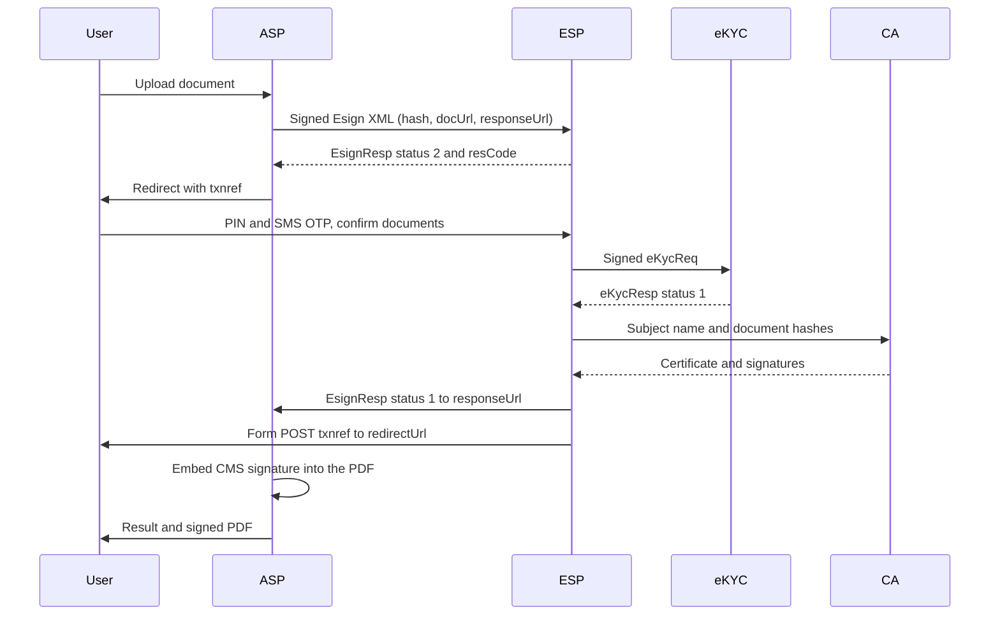

# Architecture

## asp

The application that wants a document signed.

- Stores the file. For CMS signature types, builds a PDF, publishes that PDF at `docUrl`, and sends the SHA-256 of its byte range.
- Builds `Esign` version 3.3, signs it, and posts it to the ESP.
- Receives the asynchronous response and can poll `EsignStatus`.
- Checks each returned signature, then writes `PKCS7`, `PKCS7pdf`, and `PKCS7complete` into the PDF placeholder.

## esp

The eSign service provider.

- Validates the ASP XML signature, version `3.3`, timestamp (±30 minutes), ASP id, transaction id, and up to five documents.
- Shows the document link and hash, then collects PIN plus SMS OTP.
- Calls eKYC, then the CA, and callbacks the ASP on success, cancellation, authentication failure, or timeout.
- Keeps transactions in memory so status can be read again. A production ESP must retain them for at least 30 days; this process keeps them until restart.

## ekyc

The identity store the ESP calls. The ASP never receives KYC attributes.

- Demo account plus `POST /api/v1/accounts` for new signers.
- `eKycReq` / `eKycResp` with PIN and an optional second factor. Missing second factor returns `status="2"`.
- Bank KYC XML (`BankKYC`, version 1.0) and organisational KYC XML (`OrgKYC`).
- Subscriber login by PIN, PIN change, profile update, and signing history.

## ca

Issues a one-time certificate for the signer name returned by eKYC and signs each document hash. The end-entity private key is discarded after the response. Default certificate life is 24 hours.

## common

JAXB models for the specification XML, the section 5 error enum, XML-DSig, SHA-256 helpers, and detached signature creation. The four applications scan `com.esign.common`, so each one exposes `/api/v1/meta/error-codes` and `/api/v1/audit`.
