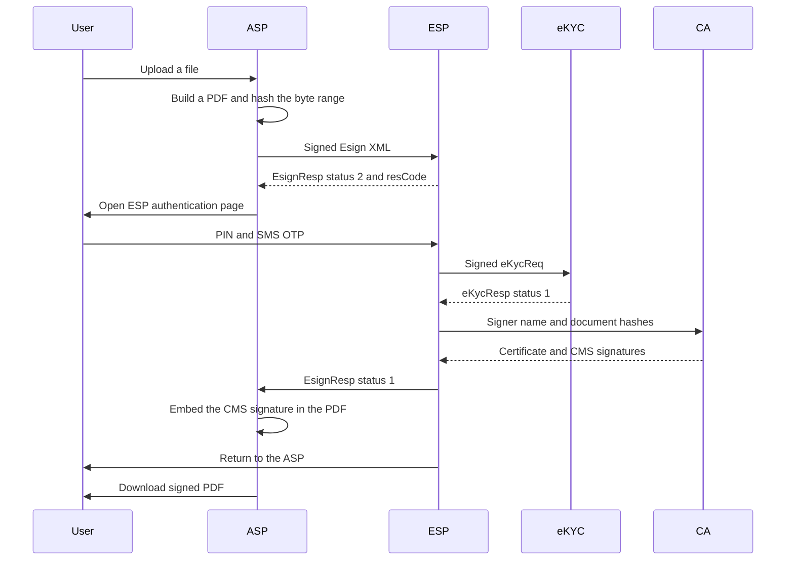

# eSign API 3.3 reference guide

This repository is a local Java implementation of the four parties in the CCA eSign API Specifications version 3.3 (09 December 2020). Each party is its own Spring Boot application. A shared library holds the XML contracts, the section 5 error catalogue, XML signatures, and hash signing.

It is a reference you can run on one machine. It is not a licensed certifying authority, it does not call UIDAI or a bank, and it does not use an HSM.

## Components

| Folder | Component | Port | Responsibility |
|---|---|---|---|
| `asp` | Application Service Provider | 8081 | The application you would build. Uploads a file, prepares a PDF, asks the ESP to sign the PDF byte-range hash, and writes the returned CMS signature into that PDF. |
| `esp` | eSign Service Provider | 8082 | Checks the ASP request, authenticates the signer, calls eKYC and the CA, and returns `EsignResp`. |
| `ekyc` | eKYC provider | 8083 | PIN, SMS OTP, bank KYC, and organisation KYC. KYC attributes stay here. The ASP never receives them. |
| `ca` | Certifying Authority | 8084 | Issues a short-lived end-entity certificate and signs each document hash. The end-entity private key is discarded after the response. |
| `common` | Shared library | — | JAXB models, `EsignErrorCode`, XML-DSig, SHA-256, and CMS / raw signatures. |



## Prerequisites and build

- JDK 17 or newer
- Maven 3.9 or newer

```powershell
mvn test
```

`common` tests cover the 69 error codes, PIN hashing, signer ids, XML validation, XML-DSig, and raw plus CMS signatures. `asp` tests cover signed PDF preparation and embedding.

## Run

Start eKYC and the CA first, then the ESP, then the ASP. From the repository root, in four terminals:

```powershell
mvn -N install
mvn -pl common install -DskipTests
mvn -f ekyc/pom.xml spring-boot:run
mvn -f ca/pom.xml spring-boot:run
mvn -f esp/pom.xml spring-boot:run
mvn -f asp/pom.xml spring-boot:run
```

`scripts/start-all.ps1`, `scripts/start-all.bat`, and `scripts/start-all.sh` install the parent POM and `common`, then open the four processes. On Windows they use a JDK and Maven already on the path, or the copies under `.tools`. The matching `stop-all` script stops the four listeners. After they answer `/api/v1/meta`, `scripts/demo.ps1` uploads a text file, completes one `PKCS7pdf` signature with the demo signer, and downloads the signed PDF.

The browser page is http://localhost:8081. Each service also publishes its own guide, with request and response examples, at `/docs.html` on its port: [8081](http://localhost:8081/docs.html), [8082](http://localhost:8082/docs.html), [8083](http://localhost:8083/docs.html), and [8084](http://localhost:8084/docs.html).

Demo signer:

| Field | Value |
|---|---|
| Signer id | `demo.user@username.ESP001` |
| PIN | `123456` |
| Mobile alias | `9876543210@Mobile.ESP001` |
| PAN alias | `ABCDE1234F@PAN.ESP001` |
| OTP | Shown on the ESP page. No SMS is sent while `esign.expose-demo-otp` is true. |

Consent text, when an eKYC request carries it, is exactly `I hereby authorize this KYC Information authentication.`

## Signed PDF

For `PKCS7`, `PKCS7pdf`, and `PKCS7complete` the ASP does not send the SHA-256 of the original file. It builds the PDF that will be signed, reserves an empty signature placeholder, and sends the SHA-256 of the PDF byte ranges. Those ranges are every byte of the file except the placeholder. That is the hash a PDF reader later checks.

- A file that is already a PDF is kept and signed with an incremental update.
- Any other file becomes a one-page PDF. The page shows the document information, the file name, and a text preview. The original bytes are attached inside the PDF.
- The signer opens that prepared PDF from the ESP page (`docUrl`).
- After a successful response, the ASP writes the CMS signature into the placeholder and serves `signed.pdf`.
- `PKCS7pdf` and `PKCS7complete` include the CA certificate in the CMS, so a reader can chain the signer certificate to the reference CA. `PKCS7` contains only the signer certificate.
- `raw` stays a detached PKCS#1 signature over the original file hash. It is not embedded, because a PDF signature dictionary expects CMS (`adbe.pkcs7.detached`).

There is no OCSP or CRL responder, so the signature does not carry revocation data. The default CA certificate life is 24 hours. The CA keystore is `data/ca/ca.p12` with password `changeit`.

Download:

```text
GET /api/v1/documents/{id}/prepared
GET /api/v1/documents/{id}/signed.pdf
GET /api/v1/documents/{id}/signature
```

`/signature` returns the hash that was signed, the CMS or raw signature, `verified`, and `signedPdf` when the PDF was written. The return page after authentication links to the same file.

## Signing flow

1. `POST /api/v1/documents` with multipart `file` and `docInfo` (1–50 characters).
2. `POST /api/v1/esign/requests` with the JSON body below. The ASP signs an `Esign` document (version `3.3`) and posts it to the ESP.
3. The ESP answers `EsignResp` with `status="2"` and a `resCode`. The ASP returns `authenticationUrl`.
4. The browser opens that URL. `txnref` is Base64 of `txn + "|" + resCode`.
5. The signer checks the document, enters the signer id, PIN, and OTP, and submits. Unchecking a document cancels only that document (error `206`).
6. The ESP calls eKYC, then the CA, posts `EsignResp` to the ASP `responseUrl`, and form-posts `txnref` to the ASP `redirectUrl`.
7. The ASP verifies the CMS against the PDF byte-range hash and embeds it.

If the callback is missed, `POST /api/v1/esign/transactions/{txn}/status` polls `EsignStatus`.

Sign request:

```json
{
  "documentIds": ["..."],
  "signerId": "demo.user@username.ESP001",
  "signingAlgorithm": "RSA",
  "responseSigType": "PKCS7pdf",
  "maxWaitPeriod": 60
}
```

`signingAlgorithm` is `RSA` or `ECDSA`. `responseSigType` is `raw`, `PKCS7`, `PKCS7pdf`, or `PKCS7complete`. Omitted, it defaults to `PKCS7pdf`. `maxWaitPeriod` is minutes from 1 to 10080. The specification default is 1440. Up to five documents can be sent in one request.

`Esign` attributes: `ver` (`3.3`), `signerid` (`id@username|Mobile|PAN.ESP001`), `ts` (ISO-8601 offset, within 30 minutes of the ESP clock), `txn` (unique per ASP and IST day, 1–50 characters from `A-Za-z0-9._:-`), `maxWaitPeriod`, `aspId`, `responseUrl`, optional `redirectUrl`, `signingAlgorithm`.

Each `InputHash` has `id` starting at 1, `hashAlgorithm="SHA256"`, 64 hex characters, `docInfo`, an `http` or `https` `docUrl`, and `responseSigType`.

XML requests and responses use enveloped XML-DSig (RSA-SHA256). Verification uses the certificate inside the signature. XML APIs return HTTP 200. A business failure is the `error` or `errorCode` attribute, not an HTTP error. JSON APIs return the HTTP status from the catalogue:

```json
{"errorCode":"204","errorMessage":"Invalid document information"}
```

Duplicate transaction `112` is raised only after a request has been accepted (`status="2"` is stored). A validation failure does not consume the transaction id.

## ASP — http://localhost:8081

| Method | Path | Purpose |
|---|---|---|
| GET | `/` | Upload and sign page |
| POST | `/api/v1/documents` | Multipart `file` and `docInfo` |
| GET | `/api/v1/documents` | Documents stored in this process |
| GET | `/api/v1/documents/{id}/content` | Original upload |
| GET | `/api/v1/documents/{id}/prepared` | PDF whose byte range was hashed |
| GET | `/api/v1/documents/{id}/signed.pdf` | PDF with the CMS signature embedded |
| GET | `/api/v1/documents/{id}/signature` | Signature, certificate, verification, and signed-PDF path |
| POST | `/api/v1/esign/requests` | Start signing. Returns `authenticationUrl` |
| POST | `/api/v1/esign/callback` | ESP `responseUrl`. Body is `EsignResp` |
| POST | `/api/v1/esign/return` | Form field `txnref` from the ESP redirect |
| GET | `/api/v1/esign/transactions/{txn}` | Last known state |
| POST | `/api/v1/esign/transactions/{txn}/status` | Poll the ESP |
| GET | `/api/v1/esign/transactions` | Transactions in memory |
| GET | `/api/v1/meta` | Component name and spec version |
| GET | `/api/v1/meta/certificate` | PEM of the ASP XML signing certificate |
| GET | `/api/v1/meta/error-codes` | Section 5 catalogue |
| GET | `/api/v1/audit` | Recent audit events |
| GET | `/actuator/health` | Process health |

Configuration in `asp/src/main/resources/application.yml`:

| Property | Default | Meaning |
|---|---|---|
| `esign.asp-id` | `ASP001` | `aspId` sent to the ESP |
| `esign.public-base-url` | `http://localhost:8081` | Prefix for `responseUrl`, `redirectUrl`, and `docUrl` |
| `esign.esp-sign-url` | `http://localhost:8082/api/v1/esign` | ESP `Esign` endpoint |
| `esign.esp-status-url` | `http://localhost:8082/api/v1/esign/status` | ESP `EsignStatus` endpoint |
| `esign.esp-auth-url` | `http://localhost:8082/api/v1/esign/auth` | Signer page |
| `esign.data-dir` | `data/asp` | Original file, `prepared.pdf`, and `signed.pdf` |
| `spring.servlet.multipart.max-file-size` | `20MB` | Upload limit |

Uploads survive an ASP restart on disk, but the in-memory index does not. A restart forgets document ids until the next upload.

## ESP — http://localhost:8082

| Method | Path | Purpose |
|---|---|---|
| POST | `/api/v1/esign` | `Esign` request. Ack is `EsignResp` with `status="2"` |
| POST | `/api/v1/esign/status` | `EsignStatus`. The response uses the same shape, including a pending request |
| GET | `/api/v1/esign/auth?txnref=` | Signer page |
| POST | `/api/v1/esign/auth` | Form fields `txnref`, `signerId`, `pin`, `otp`, and one `doc` value for each document to sign |
| POST | `/api/v1/esign/auth/otp` | JSON `{ "txnref", "signerId" }`. Demo mode adds `demoOtp` |
| GET | `/api/v1/meta` | Component name |
| GET | `/api/v1/asps` | Onboarded application providers and their certificates |
| POST | `/api/v1/asps` | Register or replace an ASP: `{ "aspId", "name", "certificatePem" }` |
| POST | `/api/v1/asps/fetch` | Same, but the ESP fetches `{ "certificateUrl" }` |
| DELETE | `/api/v1/asps/{aspId}` | Remove an onboarded ASP |
| GET | `/api/v1/meta/certificate` | PEM of the ESP XML signing certificate |
| GET | `/api/v1/meta/error-codes` | Section 5 catalogue |
| GET | `/api/v1/audit` | Recent audit events |

Configuration:

| Property | Default | Meaning |
|---|---|---|
| `esign.esp-id` | `ESP001` | Signer ids must end with this id |
| `esign.data-dir` | `data/esp` | Onboarded ASP certificates in `asps.json` |
| `esign.ekyc-url` | `http://localhost:8083/api/v1/ekyc` | eKYC request |
| `esign.otp-url` | `http://localhost:8083/api/v1/otp` | OTP issue |
| `esign.ca-url` | `http://localhost:8084/api/v1/certificates` | Certificate and hash signing |

The ESP checks the ASP XML signature, then accepts the request only when `aspId` is onboarded and the certificate inside the signature is the one registered for that ASP. An unknown ASP is error 106 on `Esign` and 301 on `EsignStatus`. A valid signature from a different certificate is 104 on `Esign` and 301 on status. The console page [Applications](http://localhost:8082/#applications) registers an ASP by fetching its PEM or pasting it. The reference ASP keeps its signing key in `data/asp/asp.p12` (password `changeit`) so the registered certificate still matches after a restart. The ESP also checks version, timestamp, transaction id, and at most five documents. It keeps transactions in memory. A production ESP must retain them for at least 30 days. This process keeps them until restart. An expiry scheduler runs every 30 seconds and completes a timed-out request with error `113`.

Only `SMSOTP` is enabled as a second factor. TOTP, mobile access tokens, FIDO, and public-key authentication are rejected with a descriptive eKYC error.

PIN check: the eKYC value is lowercase hex `SHA-256(txn + SHA-256(pin))`. The OTP value on the wire is lowercase hex `SHA-256(otp)`, not the OTP digits. The authentication page shows the digits only because demo mode is on.

## eKYC — http://localhost:8083

| Method | Path | Purpose |
|---|---|---|
| POST | `/api/v1/ekyc` | `eKycReq`. The success response stays on this service. The ASP does not receive it |
| POST | `/api/v1/otp` | `{ "signerId", "txn" }` issues a 6-digit OTP that expires in 5 minutes |
| POST | `/api/v1/bank-kyc` | `BankKYC` version `1.0` |
| POST | `/api/v1/org-kyc` | `OrgKYC` version `1.0` |
| POST | `/api/v1/accounts` | Enrol a signer |
| POST | `/api/v1/subscriber/login` | `{ "signerId", "pin" }` returns a bearer token (30 minutes) |
| POST | `/api/v1/subscriber/pin` | Bearer token. `{ "currentPin", "newPin" }` |
| GET | `/api/v1/subscriber/profile` | Bearer token |
| POST | `/api/v1/subscriber/profile` | Bearer token. Email, address, state, postal code |
| GET | `/api/v1/subscriber/history` | Signing history for the logged-in signer |
| GET | `/api/v1/meta` | Component name |
| GET | `/api/v1/meta/error-codes` | Section 5 catalogue |
| GET | `/api/v1/audit` | Recent audit events |

Configuration: `esign.expose-demo-otp` (default `true`) and `esign.seed-demo-user` (default `true`). Turn the OTP flag off before any shared deployment.

Five failed authentication attempts lock that signer for that transaction. A completed eKYC transaction is not replayed. A second factor can be composite or independent. A missing second factor returns eKYC `status="2"`.

`BankKYC` and `OrgKYC` are signed XML. The service verifies the signature after the XML parses, so a malformed body maps to `401` or `501` rather than a signature code. IFSC is optional in API 3.3. When it is present it must be 11 letters or digits, otherwise `406`.

API 3.3 removed the old organisational option-1 request and kept error codes 501–521. `OrgKYC` is the payload this project validates against that list. `physicalVerification` must contain the person's name. Either PAN or the last four digits of Aadhaar is required.

## CA — http://localhost:8084

| Method | Path | Purpose |
|---|---|---|
| GET | `/api/v1/ca/certificate` | PEM of the reference CA |
| POST | `/api/v1/certificates` | Issue a signer certificate and sign the supplied hashes |
| GET | `/api/v1/meta` | Component name |
| GET | `/api/v1/meta/error-codes` | Section 5 catalogue |
| GET | `/api/v1/audit` | Recent audit events |

```json
{
  "subjectName": "Demo Signer",
  "signingAlgorithm": "RSA",
  "documents": [
    {"id": "1", "hashHex": "<64 hex chars>", "responseSigType": "PKCS7pdf"}
  ]
}
```

The response carries `certificateBase64` (DER), `certificatePem`, `caCertificateBase64`, and `signatures`. A bad hash or signature type is reported on that item (`201` or `202`) and does not fail the other documents.

`raw` is PKCS#1 DigestInfo for RSA, or ECDSA over the 32-byte hash. `PKCS7` is detached CMS with the signer certificate only. `PKCS7pdf` and `PKCS7complete` add the CA certificate. The CMS `message-digest` attribute is the precomputed SHA-256. The signed content bytes are empty, which matches an eSign hash that was computed by the ASP before the call.

Configuration:

| Property | Default | Meaning |
|---|---|---|
| `esign.data-dir` | `data/ca` | PKCS#12 directory |
| `esign.keystore-password` | `changeit` | CA keystore password |
| `esign.certificate-validity-hours` | `24` | End-entity certificate lifetime |

The CA is created on first start as a self-signed RSA 2048 certificate. End-entity keys are RSA 2048 or EC secp256r1, with `digitalSignature` key usage.

## Error codes

`GET /api/v1/meta/error-codes` on every app returns the same 69 codes. The enum is `com.esign.common.error.EsignErrorCode`.

### 5.1 eSign response

| Code | Message | HTTP |
|---|---|---|
| 101 | Invalid Request Format | 400 |
| 102 | Invalid Signer ID | 400 |
| 103 | Invalid Version | 400 |
| 104 | XML Signature validation failed | 400 |
| 105 | Invalid transaction ID | 400 |
| 106 | Invalid ASP ID | 400 |
| 107 | Invalid Digital Signature | 400 |
| 108 | Minimum one document is required | 400 |
| 109 | Request exceeds Maximum number of documents allowed | 400 |
| 110 | Invalid Timestamp | 400 |
| 111 | Invalid Maximum Wait Period | 400 |
| 112 | Duplicate Transaction ID | 409 |
| 113 | User Timeout. Maximum Wait Time expired. | 408 |
| 114 | Authentication failed. User credentials invalid. | 401 |
| 199 | Unknown error / Custom error from ESP | 500 |

`107` means the XML-DSig `Signature` element is missing. `104` means a signature is present and did not validate. `111` is used when `maxWaitPeriod` is outside 1 to 10080.

### 5.2 eSign document

| Code | Message | HTTP |
|---|---|---|
| 201 | Invalid Document Hash | 400 |
| 202 | Invalid response signature type | 400 |
| 203 | Invalid document URL | 400 |
| 204 | Invalid document information | 400 |
| 205 | Invalid hash algorithm | 400 |
| 206 | Document cancelled by user | 400 |
| 299 | Unknown error / Custom error from ESP | 500 |

The hash must be 64 hex characters. `hashAlgorithm` must be `SHA256`. `docInfo` is required and at most 50 characters. `docUrl` must be `http` or `https`.

### 5.3 eSign status

| Code | Message | HTTP |
|---|---|---|
| 301 | Invalid Request Format | 400 |
| 302 | Transaction number not found | 404 |
| 303 | Invalid Version | 400 |
| 399 | Unknown error / Custom error from ESP | 500 |

A bad timestamp, ASP id, or XML signature on `EsignStatus` is reported as `301`. Section 5.3 has no separate signature code.

### 5.4 Bank KYC

| Code | Message | HTTP |
|---|---|---|
| 401 | Invalid Bank KYC Request XML | 400 |
| 402 | Invalid Bank Digital Signature or Bank is not registered entity in the eKYC application | 400 |
| 403 | Invalid Version Number | 400 |
| 404 | Invalid Transaction Id | 400 |
| 405 | Duplicate Transaction Id | 409 |
| 406 | Invalid Bank IFSC Code | 400 |
| 407 | Invalid Bank Name | 400 |
| 408 | KYC Information Missing | 400 |
| 409 | Invalid Common Name | 400 |
| 410 | Invalid Mobile Number | 400 |
| 411 | Invalid Email Id | 400 |
| 412 | Invalid Address | 400 |
| 413 | Invalid State/Province | 400 |
| 414 | Invalid Country | 400 |
| 415 | Invalid Postal Code | 400 |
| 416 | Invalid Date of Birth | 400 |
| 417 | Invalid PAN | 400 |
| 418 | Invalid Aadhaar | 400 |
| 419 | Invalid Photo Format provided | 400 |
| 420 | Invalid Photo | 400 |
| 499 | Unknown error / Custom error from eKYC Service Provider | 500 |

Version must be `1.0`. Gender is mandatory. An account number that is not 6–18 digits is `401`. A missing photo is `420`.

### 5.5 Organisation KYC

| Code | Message | HTTP |
|---|---|---|
| 501 | Invalid Org KYC Request XML | 400 |
| 502 | Invalid Organizational Digital Signature or Org is not registered entity in the eKYC application | 400 |
| 503 | Invalid Version Number | 400 |
| 504 | Invalid Transaction Id | 400 |
| 505 | Duplicate Transaction Id | 409 |
| 506 | Invalid KYC Org Id | 400 |
| 507 | Invalid Organization Name | 400 |
| 508 | Invalid Organization Signatory Name | 400 |
| 509 | Invalid Organizational Signatory Certificate Identifier | 400 |
| 510 | KYC Information is Missing | 400 |
| 511 | Invalid Employee Id | 400 |
| 512 | Invalid Name | 400 |
| 513 | Invalid Mobile Number | 400 |
| 514 | Invalid Email Id | 400 |
| 515 | Invalid Date of Birth | 400 |
| 516 | Invalid Gender | 400 |
| 517 | Invalid PAN | 400 |
| 518 | Invalid Aadhaar | 400 |
| 519 | Invalid Photo Format | 400 |
| 520 | Invalid Photo | 400 |
| 521 | Invalid Physical Verification Tag | 400 |
| 599 | Unknown error / Custom error from eKYC Service Provider | 500 |

`physicalVerification` must contain the person's name. A bad PAN is `517`. Missing both PAN and the last four digits of Aadhaar is also `517`.

## What this reference does not do

- It does not integrate with a licensed ESP, CA, UIDAI, bank, or SMS gateway.
- Signer, transaction, and KYC records are in memory.
- Revocation (OCSP / CRL) is not published or embedded.
- PDF signatures are detached CMS over the byte range. They are not PAdES-B-LTA and they do not include a timestamp authority.
- The second factor is SMS OTP only, and demo mode returns the OTP to the caller.
